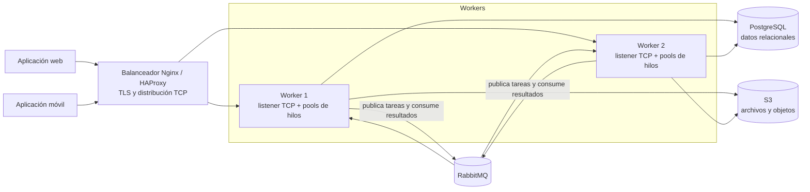

# PFO 3 — Sistema distribuido basado en sockets

Prototipo académico de un servicio TCP en Python. El cliente envía tareas como
objetos JSON y el servidor procesa varias conexiones concurrentemente con pools
de hilos. El ejemplo funciona sin dependencias externas. RabbitMQ, PostgreSQL y
S3 se describen como componentes de la arquitectura objetivo; aún no están
integrados en el código.

## Arquitectura propuesta



Los clientes se conectan a una dirección estable expuesta por Nginx o HAProxy.
El balanceador puede terminar TLS y distribuir conexiones entre workers. Cada
worker escala horizontalmente y administra pools acotados para atender conexiones
y ejecutar tareas. RabbitMQ desacopla ingreso y procesamiento: se publican
mensajes en una cola durable y los consumidores los confirman (ack) al terminar.
Las tareas deberían tener identificador de correlación, política de reintentos e
integración con una cola de errores (dead letter). PostgreSQL guarda estado y
metadatos; S3 conserva archivos, referenciados desde la base de datos. No se
deben guardar archivos grandes dentro de la cola.

El diagrama representa la arquitectura distribuida objetivo. El código incluido
implementa el tramo cliente → worker por TCP, sin RabbitMQ, PostgreSQL, S3 ni
balanceador. Para producción también hacen falta autenticación, TLS, límites de
recursos, métricas, health checks e idempotencia.

## Protocolo del prototipo

TCP es un flujo de bytes y no preserva los límites entre mensajes. Cada solicitud
y respuesta usa JSON UTF-8 terminado en `\n` (JSON Lines). El servidor admite
varias solicitudes en una conexión; el cliente de ejemplo abre una conexión por
tarea. Operaciones: `sum` (`values` numérico) y `uppercase` (`value` de texto).
Los errores de validación producen `{"ok": false, "error": ...}`.

## Ejecución local

Requiere Python 3.10 o superior. No hay paquetes externos obligatorios.

```bash
python -m server.server
```

En otra terminal:

```bash
python -m client.client
```

El servidor escucha por defecto en `0.0.0.0:5000`; el cliente usa
`127.0.0.1:5000`. Se puede cambiar el host y puerto modificando las constantes
o llamando `serve(host, port)` / `request(task, host, port)` desde Python.

## Estructura recomendada

```text
.
├── client/
│   ├── __init__.py
│   └── client.py
├── server/
│   ├── __init__.py
│   └── server.py
├── .gitignore
├── README.md
└── requirements.txt
```

